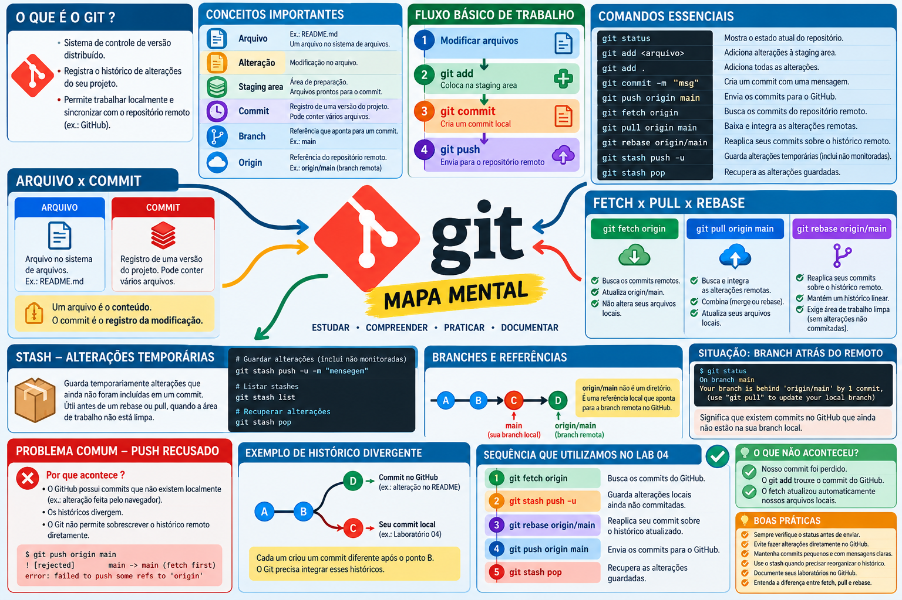

# Git Beyond Commit

### Beyond the commands. Understand the history.

**Git | GitHub | Linux | Version Control | Troubleshooting**

## 🎯 Sobre o projeto

O **Git Beyond Commit** é um projeto de estudos e laboratórios práticos dedicado à compreensão do Git e GitHub.

O objetivo não é apenas memorizar comandos, mas entender o funcionamento do controle de versão, investigar problemas reais e desenvolver autonomia técnica.

O projeto nasceu durante os estudos de Linux Essentials, após um problema de divergência entre o histórico local e o remoto.

## 🧠 Filosofia de aprendizagem

**Estudar. Compreender. Praticar. Documentar. Compartilhar.**

Cada laboratório busca registrar:

- O objetivo do estudo.
- Os comandos utilizados.
- O comportamento observado.
- Os erros encontrados.
- A investigação e a solução.
- O conhecimento adquirido.

## 📚 Conteúdos estudados

### 01 — Fundamentos do Git

- Controle de versão.
- Repositório local e remoto.
- Arquivos e commits.
- Branches e referências.
- Working Directory.
- Staging Area.

### 02 — Comandos fundamentais

| Comando | Função |
|---|---|
| `git init` | Inicializa um repositório |
| `git status` | Consulta o estado do repositório |
| `git add` | Prepara alterações para commit |
| `git commit` | Registra alterações no histórico local |
| `git log` | Consulta o histórico de commits |
| `git fetch` | Busca atualizações do remoto |
| `git push` | Publica commits no remoto |
| `git pull` | Busca e integra alterações remotas |
| `git rebase` | Reaplica commits sobre outra base |
| `git stash` | Guarda temporariamente alterações locais |

### 03 — Estrutura interna do Git

Durante o primeiro laboratório, investigamos o diretório oculto `.git` e identificamos:

- `HEAD`
- `config`
- `objects/`
- `refs/`
- `hooks/`

Também verificamos como o arquivo `HEAD` identifica a branch atual.

### 04 — Troubleshooting: histórico divergente

Durante a documentação de outro laboratório, um `git push` foi recusado porque existiam commits diferentes no repositório local e no GitHub.

A investigação envolveu:

```bash
git status
git fetch origin
git stash push -u -m "backup temporario antes do rebase Lab 04"
git rebase origin/main
git push origin main
git stash pop
```

**Aprendizado:** compreender a diferença entre buscar alterações, integrar históricos, publicar commits e preservar alterações locais ainda não commitadas.

### 05 — Troubleshooting: identidade do autor

Durante o primeiro commit deste projeto, encontramos:

```text
Author identity unknown
```

Investigamos a configuração com:

```bash
git config --list --show-origin
```

Identificamos a ausência de `user.email` e configuramos um endereço privado `noreply` do GitHub.

O primeiro commit foi registrado com sucesso.

## 🧪 Ambiente de laboratório

- Ubuntu Linux
- Terminal Bash
- Git
- GitHub
- Editor Nano


## 🚀 Evolução do projeto

Este repositório será atualizado progressivamente com novos laboratórios, exemplos práticos, diagramas e estudos sobre Git e GitHub.

---

## 🧠 Mapa mental — Git Beyond Commit

## 🚀 Evolução do projeto

Este repositório será atualizado progressivamente com novos laboratórios, exemplos práticos, diagramas e estudos sobre Git e GitHub.

---

## 🧠 Mapa mental — Git Beyond Commit

Resumo visual dos conceitos e comandos estudados nos laboratórios.



---

**Git Beyond Commit — Além dos comandos. Entenda o histórico.**esumo visual dos conceitos e comandos estudados nos laboratórios.


**Git Beyond Commit — Além dos comandos. Entenda o histórico.**
