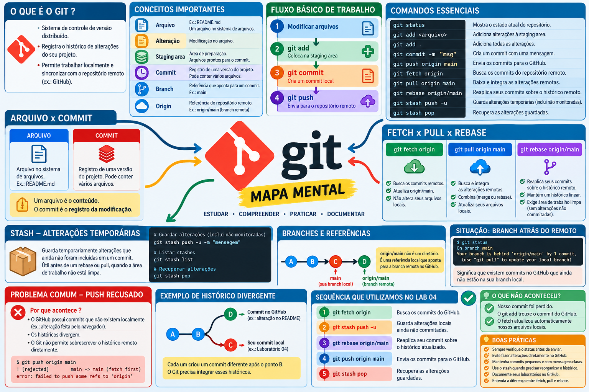

# Git Beyond Commit

### Beyond the commands. Understand the history.

**Git | GitHub | Linux | Version Control | Troubleshooting**

## 🎯 Sobre o projeto

O **Git Beyond Commit** é um projeto de estudos e laboratórios práticos dedicado à compreensão do Git e GitHub.

O objetivo não é apenas memorizar comandos, mas entender o funcionamento do controle de versão, investigar problemas reais e desenvolver autonomia técnica.

O projeto nasceu durante os estudos de Linux Essentials, após um problema de divergência entre o histórico local e o remoto.

## 🧠 Filosofia de aprendizagem

**Estudar. Compreender. Praticar. Documentar. Compartilhar.**

Cada laboratório busca registrar:

- O objetivo do estudo.
- Os comandos utilizados.
- O comportamento observado.
- Os erros encontrados.
- A investigação e a solução.
- O conhecimento adquirido.

## 📚 Conteúdos estudados

### 01 — Fundamentos do Git

- Controle de versão.
- Repositório local e remoto.
- Arquivos e commits.
- Branches e referências.
- Working Directory.
- Staging Area.

### 02 — Comandos fundamentais

| Comando | Função |
|---|---|
| `git init` | Inicializa um repositório |
| `git status` | Consulta o estado do repositório |
| `git add` | Prepara alterações para commit |
| `git commit` | Registra alterações no histórico local |
| `git log` | Consulta o histórico de commits |
| `git fetch` | Busca atualizações do remoto |
| `git push` | Publica commits no remoto |
| `git pull` | Busca e integra alterações remotas |
| `git rebase` | Reaplica commits sobre outra base |
| `git stash` | Guarda temporariamente alterações locais |

### 03 — Estrutura interna do Git

Durante o primeiro laboratório, investigamos o diretório oculto `.git` e identificamos:

- `HEAD`
- `config`
- `objects/`
- `refs/`
- `hooks/`

Também verificamos como o arquivo `HEAD` identifica a branch atual.

### 04 — Troubleshooting: histórico divergente

Durante a documentação de outro laboratório, um `git push` foi recusado porque existiam commits diferentes no repositório local e no GitHub.

A investigação envolveu:

```bash
git status
git fetch origin
git stash push -u -m "backup temporario antes do rebase Lab 04"
git rebase origin/main
git push origin main
git stash pop
```

**Aprendizado:** compreender a diferença entre buscar alterações, integrar históricos, publicar commits e preservar alterações locais ainda não commitadas.

### 05 — Troubleshooting: identidade do autor

Durante o primeiro commit deste projeto, encontramos:

```text
Author identity unknown
```

Investigamos a configuração com:

```bash
git config --list --show-origin
```

Identificamos a ausência de `user.email` e configuramos um endereço privado `noreply` do GitHub.

O primeiro commit foi registrado com sucesso.

### 06 — Evolução do aprendizado: autonomia na navegação Linux

**Data:** 06/11/2026  
**Ambiente:** Ubuntu Linux — VS Code Remote SSH

#### Objetivo

Desenvolver autonomia na utilização do terminal Linux, compreendendo a estrutura de diretórios e a diferença entre caminhos relativos e absolutos.

#### Experiência prática

Durante a navegação entre os repositórios `cybersecurity-homelab` e `git-beyond-commit`, foram realizadas diferentes tentativas para compreender como o terminal interpreta os caminhos.

```bash
cd git-beyond-commit
cd /git-beyond-commit
cd ../git-beyond-commit
```

A exploração permitiu compreender que:

- `cd git-beyond-commit` procura o diretório dentro da localização atual.
- `cd /git-beyond-commit` procura o diretório a partir da raiz `/`.
- `cd ../git-beyond-commit` retorna ao diretório pai e acessa o diretório desejado.
- `~` representa o diretório pessoal do usuário.
- `pwd` permite identificar o diretório atual.

#### Método de aprendizagem desenvolvido

**Observar → Questionar → Experimentar → Interpretar → Compreender → Documentar.**

A experiência demonstrou evolução na capacidade de navegar pelo sistema, interpretar respostas do terminal e construir soluções por meio do próprio raciocínio.

#### Conclusão

O objetivo não é apenas executar comandos corretamente, mas compreender seu funcionamento e desenvolver independência técnica para situações futuras de administração Linux, infraestrutura de redes e segurança.

**Aprendizado principal:** a autonomia é construída pela prática consciente, pela investigação e pela compreensão dos resultados.

### 07 — Git na prática: repositório remoto, upstream e publicação

**Data:** 06/11/2026  
**Ambiente:** Ubuntu Linux — Git — GitHub — VS Code Remote SSH

#### Objetivo

Compreender o ciclo de versionamento, desde a inicialização de um repositório até a publicação de commits no GitHub, identificando o papel das branches, dos repositórios remotos e do upstream.

#### Comandos estudados

| Comando | Função |
|---|---|
| `git init` | Inicializa um repositório Git local, criando o diretório `.git/`. |
| `git status` | Mostra arquivos modificados, não monitorados e preparados para commit. |
| `git add README.md` | Prepara especificamente o arquivo README.md. |
| `git add docs` | Prepara alterações nos arquivos dentro de `docs/`. |
| `git add .` | Prepara alterações do diretório atual e seus subdiretórios, incluindo arquivos não monitorados. |
| `git commit -m "mensagem"` | Registra um commit no histórico local. |
| `git remote -v` | Mostra os remotos configurados e suas URLs de busca e envio. |
| `git branch -vv` | Mostra branches locais, último commit e informações de upstream. |
| `git push -u origin main` | Envia commits e configura o acompanhamento da branch remota. |
| `git push` | Envia commits utilizando a configuração de acompanhamento existente. |

#### Compreendendo o upstream

O parâmetro `-u` é a forma abreviada de `--set-upstream`.

Na primeira publicação de uma branch:

```bash
git push -u origin main
```

- `git push`: publica commits no repositório remoto.
- `-u`: configura o acompanhamento da branch remota.
- `origin`: nome do remoto.
- `main`: branch que será publicada.

Depois que o acompanhamento está configurado, normalmente basta:

```bash
git push
```

O Git utiliza a configuração existente para determinar o destino, conforme as configurações de push.

#### Validação prática

No repositório `git-beyond-commit`, executamos:

```bash
git branch -vv
```

Resultado observado:

```text
* main f72dac9 [origin/main] docs: adiciona mapa mental de Git ao README
```

Interpretação:

- `*`: branch atualmente selecionada.
- `main`: branch local.
- `f72dac9`: identificador abreviado do último commit.
- `[origin/main]`: branch remota acompanhada.
- Texto final: mensagem do último commit.

#### Arquivos monitorados e não monitorados

Durante a atualização do README, criamos uma cópia de segurança:

```bash
cp README.md README.md.bak
```

O comando `git status` apresentou:

- `modified: README.md`: arquivo monitorado com alterações locais.
- `README.md.bak`: arquivo novo ainda não monitorado.

Aprendizado:

`git add README.md` prepara somente o README.

`git add .` também pode preparar o backup `.bak`, caso esteja dentro do diretório abrangido pelo comando.

Portanto, devemos conferir o resultado de `git status` antes de realizar commits.

#### Experiência prática — publicação de uma imagem

No repositório `cybersecurity-homelab`, transferimos uma imagem do Windows para o Ubuntu por meio do VS Code Remote SSH.

Depois, executamos:

```bash
ls -lh docs/imagens
git status
git add docs
git status
git commit -m "docs: adiciona mapa mental de Git e GitHub"
git push
```

O commit criado recebeu o identificador abreviado `4de1208`.

O envio foi confirmado pela saída:

```text
e8a0f18..4de1208  main -> main
```

Essa experiência permitiu relacionar arquivos locais, Staging Area, commits, branches e publicação remota.

#### Conclusão

O Git não se resume à execução de comandos isolados. Seu funcionamento envolve estados de arquivos, histórico local, referências, branches e sincronização com repositórios remotos.

**Aprendizado principal:** compreender o fluxo completo permite trabalhar com mais segurança, interpretar os resultados e desenvolver autonomia no controle de versão.

### 08 — VS Code Remote SSH: arquivos, workspace e integração Git

**Data:** 06/11/2026  
**Ambiente:** Windows 11 — VS Code — Remote SSH — Ubuntu Linux — Git

#### Objetivo

Compreender a integração entre o VS Code instalado no Windows e os projetos Git armazenados no Ubuntu, diferenciando arquivos abertos, diretórios, workspace e terminal integrado.

#### Experiência prática

Durante a documentação dos repositórios `cybersecurity-homelab` e `git-beyond-commit`, observamos que o VS Code permitia abrir arquivos de projetos diferentes sem necessariamente alterar a pasta principal exibida no Explorer.

O terminal estava localizado em:

```text
/home/aluno/git-beyond-commit
```

Entretanto, o Explorer ainda apresentava o projeto `cybersecurity-homelab`.

Essa observação permitiu compreender que o diretório atual do terminal e a pasta aberta no workspace são contextos distintos.

#### Comandos utilizados

| Comando | Função |
|---|---|
| `code README.md` | Abre o arquivo README.md no VS Code. |
| `code .` | Abre o diretório atual no VS Code como pasta de trabalho. |
| `pwd` | Mostra o diretório atual do terminal. |
| `ls -la` | Lista arquivos, incluindo ocultos, com informações detalhadas. |
| `ls -la ~` | Lista o conteúdo do diretório pessoal do usuário, incluindo arquivos ocultos. |
| `ls -lh` | Lista arquivos com detalhes e tamanhos legíveis para humanos. |

**Observação:** o ponto (`.`) representa o diretório atual, enquanto dois pontos (`..`) representam o diretório pai.

#### Reconhecimento do repositório Git

Durante a abertura do README, o VS Code apresentou a notificação:

```text
Git repositories were found in the parent folders
of the workspace or the open file(s).
Would you like to open the repositories?
```

Ao selecionar `Yes`, foi apresentada uma janela para escolher o repositório:

```text
Pick a repository to open

git-beyond-commit
/home/aluno/git-beyond-commit
```

Essa experiência demonstrou que o VS Code pode detectar repositórios Git em diretórios superiores aos arquivos abertos e oferecer sua integração ao ambiente de desenvolvimento.

Posteriormente, o workspace foi aberto diretamente no projeto git-beyond-commit.

#### Compreendendo a interface

| Elemento | Função |
|---|---|
| Explorer | Exibe os arquivos e diretórios do workspace. |
| Editor | Permite visualizar e modificar arquivos, inclusive de outros diretórios. |
| Terminal integrado | Executa comandos no ambiente remoto, mantendo seu próprio diretório atual. |
| Source Control | Permite acompanhar alterações e executar operações Git pela interface. |
| Remote SSH | Permite trabalhar em um sistema remoto utilizando o VS Code local. |

#### Indicadores observados no Explorer

Durante a atualização da documentação, identificamos:

- `M` — Modified: arquivo monitorado que possui alterações.
- `U` — Untracked: arquivo ainda não monitorado pelo Git.

O `README.md` apresentou o indicador `M`, enquanto o backup `README.md.bak` apresentou `U`.

Esses indicadores permitiram correlacionar a interface gráfica do VS Code com as informações apresentadas pelo comando `git status`.

#### Método de aprendizagem

**Observar → Questionar → Experimentar → Interpretar → Compreender → Documentar.**

A investigação da interface do VS Code contribuiu para compreender a relação entre o sistema operacional remoto, a estrutura de diretórios, o ambiente de edição e o controle de versão.

#### Conclusão

O VS Code Remote SSH não substitui o conhecimento do terminal Linux ou dos comandos Git. Ele oferece uma interface integrada para trabalhar com arquivos e repositórios remotos.

**Aprendizado principal:** compreender a diferença entre arquivo, diretório, workspace e terminal permite trabalhar com mais autonomia e organização em ambientes de desenvolvimento e infraestrutura.


### 09 — Troubleshooting: divergência entre repositório local e remoto

**Data:** 06/11/2026  
**Ambiente:** Ubuntu Linux — Git — GitHub — VS Code Remote SSH  
**Repositório:** `dias0001/git-beyond-commit`  
**Resultado:** Resolvido e publicado no GitHub.

#### Objetivo

Investigar a rejeição de um `git push`, compreender a divergência entre os históricos local e remoto e integrar as alterações sem perder a documentação ou as imagens existentes.

#### 1. Cenário real

Após atualizar o `README.md` com as seções 06, 07 e 08, foi criado o commit local:

```bash
git commit -m "docs: registra evolucao em Git Linux e VS Code Remote SSH"
```

**Commit:** `eccb3fd`

Ao executar `git push`, o Git recusou a publicação:

```text
! [rejected] main -> main (fetch first)
error: failed to push some refs
```

O comando `git push origin main` também foi rejeitado.

**Interpretação:** o GitHub possuía commits que ainda não estavam no histórico local. A rejeição não estava relacionada à ausência de upstream.

#### 2. Buscar as atualizações remotas

```bash
git fetch origin
```

Resultado observado:

```text
f72dac9..1fc2893 main -> origin/main
```

O `fetch` atualizou a referência remota `origin/main`, sem integrar automaticamente os commits à branch local.

#### 3. Investigar os históricos

```bash
git log --oneline --graph --decorate --all -8
```

O resultado revelou:

- `eccb3fd` — commit local com a documentação atualizada.
- `1fc2893` — alteração remota do README.
- `5d94444` — inclusão de arquivos pelo GitHub.
- `f72dac9` — ancestral comum dos dois históricos.

**Conclusão:** os históricos haviam divergido a partir de um commit comum.

#### 4. Comparar as alterações

```bash
git diff --stat main origin/main
```

A comparação identificou diferenças no `README.md` e uma imagem adicional:

```text
assets/Mapa Mental do Fluxo de Trabalho Git.png
```

Para examinar a versão remota do README sem modificar o arquivo local:

```bash
git show origin/main:README.md
```

A investigação confirmou que a versão remota continha a referência à imagem adicional, enquanto a versão local possuía a documentação mais recente.

#### 5. Integrar os históricos com segurança

```bash
git merge origin/main --no-commit --no-ff
```

Resultado:

```text
Automatic merge went well; stopped before committing as requested
```

O Git realizou a integração automática sem conflitos.

- `--no-commit`: interrompe antes de criar o commit de merge.
- `--no-ff`: solicita um commit de merge mesmo quando seria possível avançar diretamente a referência da branch.

#### 6. Validar antes de confirmar

```bash
git diff --cached --stat
git diff --cached -- README.md
```

A validação confirmou que o merge acrescentou a referência à imagem e preservou as seções 06, 07 e 08.

O arquivo `README.md.bak` permaneceu fora do commit.

#### 7. Confirmar o merge e publicar

```bash
git commit -m "merge: integra atualizacoes remotas e preserva documentacao"
git push
```

**Commit de merge:** `6fed410`

Resultado:

```text
1fc2893..6fed410 main -> main
```

A publicação foi concluída com sucesso.

#### 8. Fluxo prático executado

**Commit local → Push rejeitado → Fetch → Análise dos históricos → Merge → Commit → Push bem-sucedido.**

#### 9. Aprendizados

- Um push rejeitado não significa necessariamente que o comando esteja incorreto.
- `git fetch` busca atualizações sem integrá-las automaticamente.
- `git log --graph` ajuda a visualizar históricos divergentes.
- `git diff` permite investigar diferenças antes da integração.
- `git merge --no-commit --no-ff` permite revisar o resultado antes do commit.
- A integração deve preservar tanto o histórico local quanto o remoto.
- O backup não monitorado não precisa ser incluído no commit.

#### Conclusão

A divergência foi resolvida por meio de investigação, interpretação do histórico e integração controlada, sem sobrescrever o trabalho existente.

**Aprendizado principal:** compreender o estado do repositório antes de executar comandos é fundamental para trabalhar com segurança e autonomia.


## 🧪 Ambiente de laboratório

- Ubuntu Linux
- Terminal Bash
- Git
- GitHub
- Editor Nano


## 🚀 Evolução do projeto

Este repositório será atualizado progressivamente com novos laboratórios, exemplos práticos, diagramas e estudos sobre Git e GitHub.

---


## 🧠 Mapa mental — Git Beyond Commit

Resumo visual dos conceitos e comandos estudados nos laboratórios.




---

**Git Beyond Commit — Além dos comandos. Entenda o histórico.**
